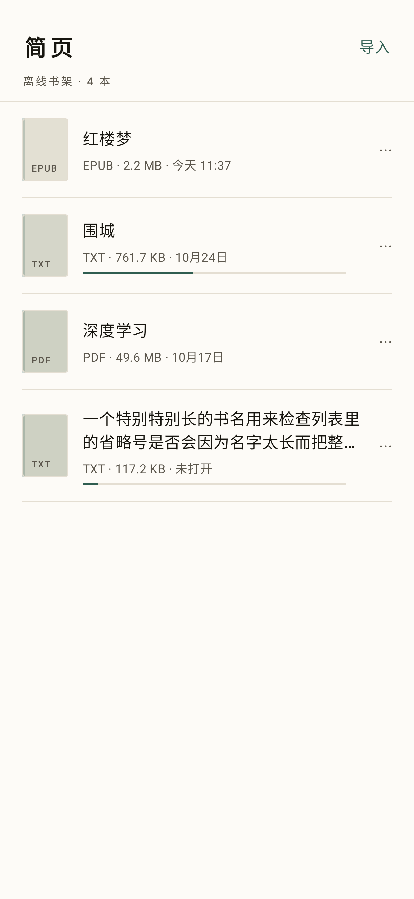
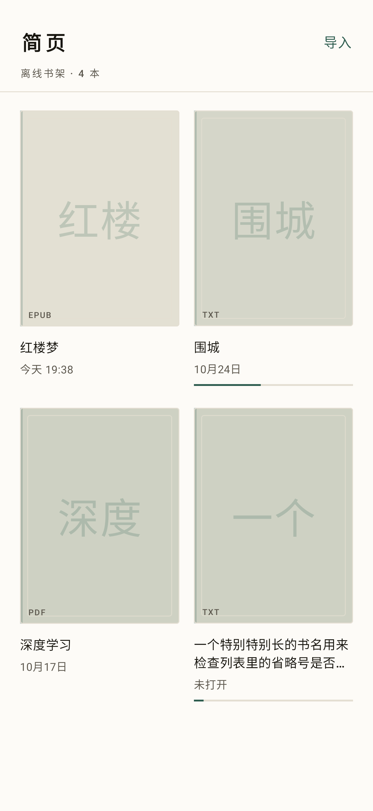
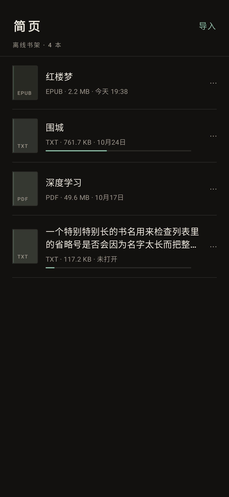
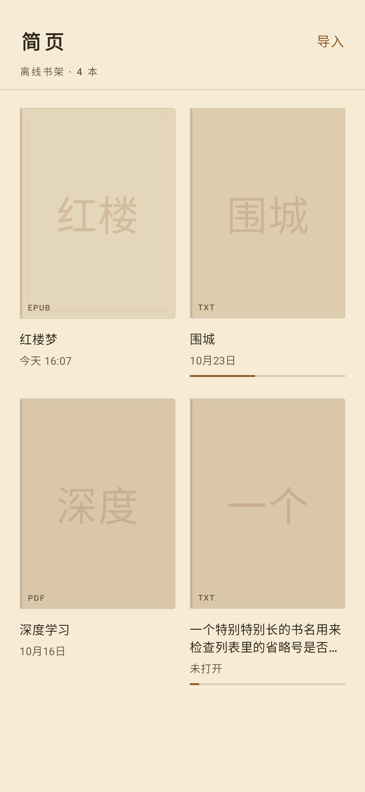
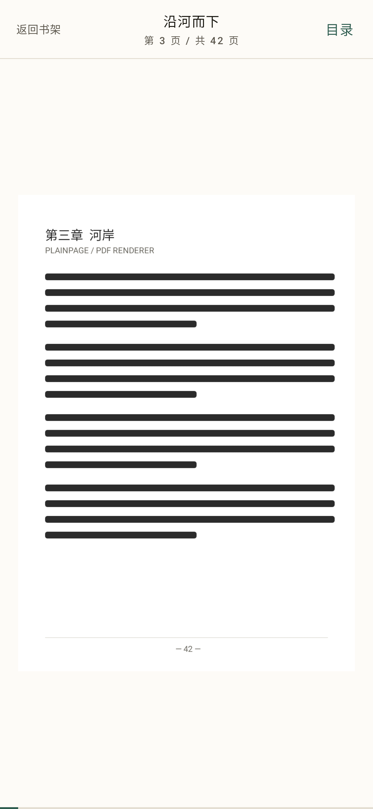
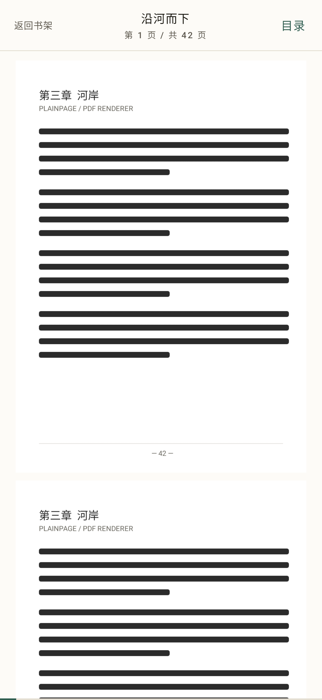

# 简页 · PlainPage

> 简页 · 离线 EPUB / TXT / PDF 阅读器

一个**完全离线**、UI 可切换、面向大文件的 Android 阅读器。Kotlin + Jetpack Compose，Apache-2.0。

| 项目 | 值 |
|---|---|
| 应用显示名 | 简页 |
| 英文名 / 仓库名 | PlainPage / `plainpage-reader` |
| Android 包名 | `io.github.galizhajidanbaofan.plainpage` |
| 最低版本 | Android 8.0（minSdk 26） |
| 主许可证 | Apache-2.0（见 [LICENSE](LICENSE)） |
| 网络权限 | **不声明** `android.permission.INTERNET`，飞行模式下功能完整 |

---

## 状态（务必先读）

**当前：构建通过，书架/导入/最近阅读已落地，TXT / EPUB / PDF 三种格式都能真的打开——TXT 与 EPUB 有分章目录与跳章，PDF 按页渲染并可按页码跳转；两种阅读模式（左右翻页 / 上下滚动）、EPUB 内插图（整页显示）、内置字体切换、进度写回与恢复都在代码里跑通并有单测。** 下表是诚实进度。

| 能力 | 代码 | 构建 | 真机验收 |
|---|---|---|---|
| 仓库骨架 / 许可证 / 文档 | ✅ | — | — |
| 构建体系（Gradle 9.8.2 / AGP 9.4.1 / Kotlin 2.3.20 / compileSdk 37） | ✅ | ✅ 通过 | — |
| 外观注入骨架（AppearanceRepository / ThemeTokens） | ✅ | ✅ 通过 | 未验证 |
| Room 数据层（book 表、书架/最近两个 Flow、进度字段） | ✅ | ✅ 通过 | 未验证 |
| SAF 导入（复制到私有目录、300 MB 上限、流式写入、来源记录） | ✅ | ✅ 通过 | 未验证 |
| 书架列表 / 网格切换 + 删除 | ✅ | ✅ 通过 | 未验证 |
| 最近阅读（按 `lastOpenedAt` 排序） | ✅ | ✅ 通过 | 未验证 |
| 打开 TXT → 正文渲染 + 翻页 | ✅ | ✅ 通过 | 未验证 |
| TXT 目录 / 跳章 / 进度恢复 | ✅ | ✅ 通过（含闭环单测） | 未验证 |
| 打开 EPUB → 正文渲染 + 翻页 | ✅ | ✅ 通过 | 未验证 |
| EPUB 目录（NCX / nav / spine 兜底）/ 跳章 / 进度恢复 | ✅ | ✅ 通过（含闭环单测） | 未验证 |
| 导入时读 EPUB 书名与作者 | ✅ | ✅ 通过 | 未验证 |
| EPUB 内插图（整页显示 + 图注） | ✅ | ✅ 通过 | 未验证 |
| EPUB 封面（OPF cover-image / meta cover / guide） | ✅ | ✅ 通过 | 未验证 |
| 阅读字体切换（默认 / 宋体 / 楷体 / 等线 / 打字机） | ✅ | ✅ 通过 | 未验证 |
| 阅读模式切换：左右翻页（禁纵向）/ 上下滚动（无翻页） | ✅ | ✅ 通过（含手势与分块单测） | 未验证 |
| 打开 PDF → 按页渲染（平台 PdfRenderer，无新依赖） | ✅ | ✅ 通过 | 未验证 |
| PDF 页码跳转 / 进度恢复（页码 + 页内比例） | ✅ | ✅ 通过（含页码换算单测） | 未验证 |
| 性能目标（冷启动 <2s、大文件不 ANR） | 未开始 | — | **未测量** |

已实测（2026-10-27）：`assembleDebug` 产出 **17.31 MiB / 18,146,505 字节** debug APK（其中约 5.8 MB 是内置楷体字体，见下）；**171 个单元测试全通过**（含 17 张离屏截图、TXT 与 EPUB 各自的「存进度→重开→同一屏」闭环、翻页手势的点击/滑动分区、滚动模式的分块换算、插图的提取/落位/整页编排、EPUB 的 ZIP 穿越 / XXE / 超限 / 损坏用例、PDF 的渲染尺寸换算与页码夹紧）；`lintDebug` **0 errors / 4 warnings**（3 条依赖版本提示、1 条自适应图标目录误报，均为已知取舍）；APK `minSdkVersion 26`、`targetSdkVersion 37`、**无 `INTERNET` 权限、无存储权限**。完整命令与原始输出见 [docs/build-verification.md](docs/build-verification.md)，分层与线程模型见 [docs/architecture.md](docs/architecture.md)，工具链细节见 [docs/environment.md](docs/environment.md)。

> **字体与包体**：内置楷体用 [LXGW WenKai Lite](https://github.com/lxgw/LxgwWenKai-Lite)（SIL OFL-1.1，允许随应用分发），字体文件 9.7 MB 放在 `app/src/main/res/font/lxgw_wenkai_lite.ttf`，压缩后约给 APK 增加 5.8 MB——这是当前包体里最大的一块。宋体 / 等线 / 打字机用系统字体族名，不额外占包体；「默认」就是系统无衬线。如果后续要压包体，可行方向是按需下载字体包（但会打破「默认不联网」，需要单独决策），或者只保留一个内置字体。

尚未验证：导入 / 打开 / 跳转 / 进度恢复的设备端行为（本机模拟器无法启动，详见 docs/build-verification.md）、release 混淆构建、性能门禁。

> **借用别人的机器验证时**：`./gradlew :app:assembleDebug` 后把 `app-debug.apk` 装到 Android 8.0+ 设备，走一遍「导入 → 书架 → 删除」，再把 Logcat 里 `PlainPage` 标签的内容贴到 Issue。

---

## 界面实拍（不是效果图）

本机跑不起 Android 模拟器（宿主虚拟化与图形都不满足，详见 [docs/preview-device.md](docs/preview-device.md)），所以用 Robolectric 的原生图形把 Compose 界面**真的画成 PNG**：`./gradlew :app:testDebugUnitTest --tests "*ScreenshotTest*"`，产物在 `app/build/screenshots/`，仓库里同步了一份。

| 书架 · 列表（浅色） | 书架 · 网格（浅色） | 空书架 |
|---|---|---|
|  |  |  |

| 书架 · 列表（深色） | 书架 · 网格（护眼） | 设置（浅色） | 设置（深色） |
|---|---|---|---|
|  |  |  |  |

| 阅读 · 浅色 | 阅读 · 护眼 | 阅读 · 深色 |
|---|---|---|
|  |  |  |

| 阅读 · 上下滚动模式 | 阅读 · EPUB 整页插图 |
|---|---|
|  |  |

| 阅读 · 楷体（内置） | 阅读 · 打字机 |
|---|---|
|  |  |

| PDF · 按页渲染（浅色） | PDF · 上下滚动 |
|---|---|
|  |  |

阅读页有两种模式，在「设置 → 翻页方式」里切换：

- **左右翻页**：轻点屏幕左 1/3 翻上一页、右 1/3 翻下一页，中间不动；左右滑动也能翻页；纵向滑动不翻页、也不会滚动正文。
- **上下滚动**：整本连续下滚，没有「上一页 / 下一页」，左右滑动不翻页（避免用户比划一下页面就偷偷跳走）。

两种模式共用同一套进度坐标（全书字符偏移），所以随时切换都能接上；底部只保留一条 2dp 的进度线，不再有页码与上一页/下一页按钮。

设计取向与规则（配色、字阶、间距、为什么不用卡片和浮动按钮）写在 [docs/design-system.md](docs/design-system.md)。

这些图验证的是**渲染与布局**（列表/网格结构、三种配色、超长书名省略、最近阅读时间格式、正文段首缩进与进度线、滚动模式的分块渲染）。字体切换那张图同时证明内置楷体真的被加载了（字体资源缺失时会静默回退系统字体，截图就会和「默认黑体」一模一样）。点击、滑动翻页、返回键、SAF 选择器、Room 落库等行为仍必须上设备验证——截图通过 ≠ 功能通过；其中翻页手势与滚动分块另有 JVM 行为测试兜底（`ReaderGestureTest`、`ScrollChunkMathTest`）。

---

## 目标范围

### P0（第一个可用版本）

1. **书架**：导入、展示、删除记录；显示标题 / 封面或占位 / 格式 / 最近阅读时间。
2. **最近阅读**：按最近打开时间排序，一键续读。
3. **导入**：SAF 文件选择器（EPUB / TXT / PDF），不申请 `MANAGE_EXTERNAL_STORAGE`，持久化 URI 授权，**默认复制到应用私有目录**并记录原始来源。
4. **打开与目录**：三种格式均可打开、基础渲染、章节目录、点击跳转。
5. **进度记忆**：按书籍保存位置 —— EPUB 用 locator（href + 章节内偏移/百分比），PDF 用页码，TXT 用字符偏移。
6. **异常处理**：损坏文件、编码异常、权限丢失、空目录、超大文件，都要有人话提示而不是崩溃。

### P1

页面设置（字体 / 字号 / 行距 / 页边距 / 对齐 / 主题 / 翻页或滚动 / 亮度）、书架列表与网格切换、阅读主题切换（浅色 / 深色 / 护眼）、阅读模式切换（翻页 / 滚动）。

### 明确不做

OCR、PDF 文本选择与批注、DRM、账号、云同步、网络请求、TTS、翻译、插件系统；不申请危险存储权限，不删除用户原文件，不上传任何数据。

---

## 设计要点

```
UI (Compose)  ──按配置注入──▶  ThemeTokens / LayoutMode / 书架布局
      │
      ▼
ReaderEngine（统一接口：open / loadOutline / restoreProgress / saveProgress / render / close）
      ├── TxtReaderEngine    自研编码识别 + 分章
      ├── EpubReaderEngine   自研最小 EPUB2/3 解析（ZIP + OPF spine + NCX/nav）
      └── PdfReaderEngine    Android PdfRenderer 渲染（P0 不含大纲）
      │
      ▼
Repository（Room 存书目与进度，DataStore 存外观设置，文件在私有目录）
```

- **UI 可切换是配置，不是 if 分支**：外观/布局通过 `AppearanceRepository` + `ThemeTokens` + `LayoutMode` 注入，业务层不认识主题。
- **主线程只做 UI**：所有 IO / 解析 / 渲染准备都在 Dispatchers.IO 或专用单线程调度器上，大文件流式读取、按章加载、缓存有上限。
- **EPUB 与 PDF 都不引重依赖**：EPUB 自研解析（避免 WebView 排版与包体代价），PDF 用平台 `PdfRenderer`；P0 不引 PdfBox（其依赖链会带进 BouncyCastle 三件套）。

---

## 构建

需要：**JDK 17+**（实测 JDK 21）、Android SDK Platform `android-37.0`、Build-Tools `36.0.0`。Gradle 由仓库内 wrapper 提供（9.8.2），无需预装。

```bash
git clone https://github.com/galizhajidanbaofan/plainpage-reader.git
cd plainpage-reader
./gradlew :app:assembleDebug        # 构建 debug APK
./gradlew :app:testDebugUnitTest    # 单元测试（151 个，含 13 张截图）
./gradlew :app:lintDebug            # Lint
```

产物：`app/build/outputs/apk/debug/app-debug.apk`。

- 版本号一律以 [`gradle/libs.versions.toml`](gradle/libs.versions.toml) 为准，不在文档里写死。
- **Kotlin 固定 2.3.20，别随手升 2.4.x**：KSP 最新版 `2.3.12` 只针对 Kotlin 2.3.20 构建，升 Kotlin 会让 `:app:kspDebugKotlin` 以 `ExceptionInInitializerError` 失败（Room 依赖 KSP）。
- 若 `ANDROID_HOME` 未设置，在项目根目录建 `local.properties` 写 `sdk.dir=<你的 SDK 路径>`（该文件已被 git 忽略）。
- 常见坑（AGP 9 内置 Kotlin、platform 37 目录名、build-tools 36.0.0、KDoc 里写 `*/` 会把注释提前闭合等）与本机实测输出见 [docs/build-verification.md](docs/build-verification.md)。

---

## 隐私

- 无网络权限，无任何网络代码路径。
- 书籍文件只存在应用私有目录；导入时记录**来源 URI** 仅供显示与「缺失提示」，不上传。
- 无统计、无崩溃上报、无广告 SDK。

---

## 许可证与第三方

主许可证 Apache-2.0，全文见 [LICENSE](LICENSE)。署名信息见 [NOTICE](NOTICE)，逐条第三方依赖与许可证证据见 [THIRD-PARTY-NOTICES.md](THIRD-PARTY-NOTICES.md)。

引入任何依赖前必须：核对 POM/AAR 中的许可证 → 记入清单 → 确认不是 AGPL/GPL。

---

## 发布前提醒

`PlainPage` / `简页` 可能与已有产品重名，上架（尤其 Google Play 与国内商店）前请自行完成**商店名与商标检索**；仓库名使用 `plainpage-reader` 以降低混淆。

---

## 贡献

项目早期，接口仍在变动。欢迎以 Issue 形式提出格式兼容问题（请附最小可复现样本的**来源说明**，勿上传有版权的整本书）。
